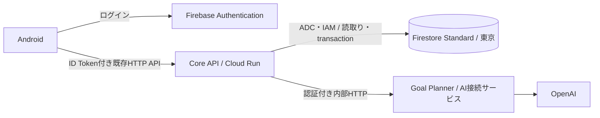

# Firestore Standard 移管計画書

- 作成日: 2026-11-03（日本時間）
- 状態: Firestoreへ切替・旧SQL即時撤去済み（2026-11-03）。課金反映の確認待ち
- 対応Issue: [#23 Cloud SQLをFirestore Standardへ置換する](https://github.com/Yoshiki-Takahashi/life_agent/issues/23)
- 進捗・受け入れ結果の正本はIssueとする。この文書は移管の設計・実施順序・判定条件を定める。

## 1. 目的と完了状態

Cloud SQLの継続費用をなくし、現在の目標管理・実績記録・再計画・コーチをFirestore Standardで提供する。
既存のテストデータは移さず、Firestoreを空の状態で開始する。
Firebase Authenticationのアカウントは維持するため、既存の利用者は同じアカウントでログインし、新しく目標を作成できる。

完了状態は、既存Androidから一連の操作ができ、保存・認証・競合の検証に合格し、
旧Cloud SQLと専用依存を撤去した状態とする。当初の48時間保持は、切替検証後のユーザー指示により即時削除へ変更した。
費用の削減結果は課金データの反映後に確認する。実装・切替・撤去と、課金反映後の削減確認を分けて記録する。

## 2. ユーザーの決定事項

| 項目 | 決定内容 |
| --- | --- |
| 保存先 | Firestore Standard、Native mode |
| プロジェクト・リージョン | 既存の `lifeagent-505614`、東京 `asia-northeast1` |
| 既存データ | 旧Cloud SQLのテストデータを引き継がず、空のDBで開始 |
| 切替時の停止 | 短時間のメンテナンスを許容 |
| 定期バックアップ | 設けない。PITRも有効化しない |
| 切替時の退避 | 旧PostgreSQLをローカルPCだけに退避し、保存期限はユーザーが管理 |
| 旧Cloud SQL | 切替検証後に即時削除（ユーザーが当初の48時間保持を撤回） |

切替日時は実装・リハーサル後にユーザーへ確認し、「今から実施する」の回答後、rate limitによる中断を経て
再開指示に基づき2026-11-03 23:36〜23:39（日本時間）に実施した。停止時間は約3分18秒だった。
データ継承、定期バックアップ、配置などに追加の選択が必要になった場合は、実装側で決めずユーザーへ質問する。

定期バックアップを設けないため、切替後にFirestoreへ保存したデータを、切替前の退避ファイルから復元することはできない。
切替時のローカル退避は、旧テスト環境へ戻すためのものである。

## 3. 現状と調査範囲

2026-11-03の読み取り確認では、Cloud SQL `lifeagent-dev-db` は `RUNNABLE / ALWAYS`、
東京・`db-f1-micro`で、自動バックアップは無効だった。
Firestore APIは無効で、DB一覧取得は `SERVICE_DISABLED` で終了した。
既存Firestore DBの有無・無料枠の対象DBは未確認であり、「DBが存在しない」とは断定しない。
API有効化後、作成前にDB一覧と設定を確認する。想定外の既存DBがあれば自動削除・変更せずユーザーへ相談する。

現在の依存箇所は次のとおり。

| 配置 | 現状と変更範囲 |
| --- | --- |
| Core API `database.py` / `models.py` | SQLAlchemyのSession・ORMからFirestoreクライアントと固定保存モデルへ変更 |
| `goals.py` / `progress.py` / `replan.py` / `coach.py` | SQL読取り・行ロック・transactionをFirestore向けに変更。業務責務は維持 |
| `config.py` / `pyproject.toml` | Firestore接続設定・依存を追加し、移行完了時に不要なSQL依存を削除 |
| `tests/conftest.py` | 現在のSQLiteベースのAPIテストをFirestore Emulatorへ変更 |
| `tests/e2e/` | PostgreSQLの行ロック前提を外し、同時実行・再送という利用者の振る舞いを維持 |
| `.github/workflows/` | Emulator起動、索引準備、Cloud SQL migration Jobと必須変数・Secretの参照を整理 |
| `scripts/gcp/` / `infra/gcp/` | status/start/stop/setup/destroy、予算設定、運用手順を新構成に合わせる |

上記は計画作成時の調査結果である。その後、開発着手に伴いAPI有効化とDB一覧確認を行い、既存DBがないことを確認して
東京の`(default)`をStandard / Native modeで作成した。無料枠対象・PITR無効を確認し、IAM・Rules・索引を準備済み。
実行アカウントのCloud Run Jobで実Firestoreの結合検証に合格した。
候補をトラフィックなしで検証後、2026-11-03 23:39にFirestore版へ100%切替した。
旧SQLの最終退避をローカルPCだけに保存し、隔離DBへ復元検証済み。書込み排出と旧SQLの更新カウンタ不変を確認した。
Androidで実Firebase・実AI・Firestoreを通す保存・再送・助言・再計画・再訪に合格し、検証データを削除した。
48時間観察は23:41に開始したが、その後ユーザーが「48時間後ではなく即時削除」を指示したため撤回した。
旧SQLと専用依存を同日23:48に撤去済み。クラウドの残存SQL・バックアップがないことと新構成の正常性を確認した。
課金表示への反映と削減実績の確定は未実施。
実施手順と記録は[移管ランブック](../../infra/gcp/firestore-migration-runbook.md)を参照する。

## 4. 移管後の責務



- Core APIだけが正本データへアクセスする。AndroidへのFirestore SDK追加・直接接続は行わない。
- Firebase ID Tokenの検証、所有者認可、候補の再検証、確認後の保存はCore APIに残す。
- Goal Planner / AI接続サービスは引き続きステートレスとし、DB権限を付与しない。
- 公開URL、APIパス、UUID、公開JSON、HTTPの成功・失敗条件を維持し、既存Androidで利用できるようにする。
- Room化、オフライン同期、リアルタイム購読、会話の永続化、画面機能の追加は対象外。
- 既存の機能ファイルを拡張し、Firestoreを理由に新しいサービスや汎用DBフレームワークを追加しない。
  PostgreSQLとFirestoreの恒久的な二重対応・二重書込みも行わない。

保存方式変更のADRを実装時に追加する。現行仕様の `system-architecture.md`、`api.md`、
`service-design-guidelines.md`、`development-infrastructure.md`、開発手順も実装と同じ変更で更新する。
現行docsにはFirestoreの実装、切替実績、即時削除への方針変更・旧SQL撤去の結果を記録する。

## 5. 保存モデル案

DB IDは `(default)` とし、無料枠対象であることを作成後にも確認済み。
コレクションとフィールドは固定し、保存前にPydanticで検証する。AIにDB Schemaを生成させない。

| 保存先 | 内容・設計 |
| --- | --- |
| `goals/{goal_uuid}` | 所有者UID、目標、期限、状態、計画版、日時、Metric定義と現在値、中間目標 |
| `goals/{goal_uuid}/progress_logs/{request_key}` | 実績の公開UUID、元の保存ID、本文、日時、Metric ID別の今回値 |
| `goals/{goal_uuid}/replan_proposals/{proposal_uuid}` | 所有者UID、基準計画版、理由、候補Plan、差分、適用状態・日時 |

Metricは既存のpositionとUUIDを維持して更新し、非表示の定義も残す。
現在の実装は同じpositionの定義を再利用し、Metricの位置は最大3つ、中間目標は最大5つである。
したがって、この定義部分はGoal文書へ格納し、件数が増え続ける実績と再計画候補は別文書へ分離する。
過去の実績のMetric名・単位は、既存と同じID参照の意味を維持し、勝手に「保存時の名称」へ仕様変更しない。

型と重複防止の規則は次のとおり。

- 数値は小数2桁を100倍した整数として保存する。例: `1.25 → 125`。
  現在値・目標値・今回値・再計画候補の数値に同じ変換を適用し、公開APIとの境界でDecimalを使って変換する。
  バイナリ浮動小数の加算を保存の正本にしない。
- UUIDは文字列、日付はISO日付、日時はUTCのFirestore Timestampとし、APIの日時表現と順序を維持する。
- `request_key`は `client_request_id` のUTF-8をSHA-256にした値とする。
  `/`などを含む既存の保存IDを安全に扱い、Goal単位で一意にする。公開するProgressLog IDは別のUUIDとする。
- 本文・候補Plan・diffを含めて固定モデルで検証する。文書上限1MiBを超える保存を検出し、部分保存しない。
- 内部 `schema_version` を持たせ、将来の保存形式変更で既存文書の読取りを明示的に管理する。
  公開APIのSchemaのコピーやスナップショットは増やさない。

### 読取りと索引

| 操作 | 読取り方針 |
| --- | --- |
| 目標一覧 | `owner_id`で限定し、`updated_at desc, id desc`。実績の全件取得・Goalごとの追加読取りを行わない |
| コーチ | 所有Goalの必要項目だけを取得。既存の`created_at, id`順を維持し、全実績を取得しない |
| 詳細・グラフ | Goalの所有者確認後、実績を`recorded_at desc, id desc`で取得。現行APIの全履歴返却を維持 |
| 助言 | Goalと直近10件の実績を取得し、全履歴読取り後のスライスを避ける |
| 再計画 | 必要な現行計画と現在値を取得し、候補はIDで直接取得 |

上記クエリに必要な複合索引を `infra/gcp/` 配下の設定として管理し、切替前に作成完了を確認する。
検索しない本文・説明・metrics・milestones・候補Plan・diff等の自動索引を除外する。
一覧の件数はGoal内の定義から計算し、別コレクションへの件数照会は行わない。

全履歴返却は利用期間に応じて読取り料金が増える制約として記録する。
今回の移管で履歴を打ち切らず、ページングが必要になった場合はAndroid/API変更を別Issueで判断する。

## 6. 保存・競合・認証の維持

### 実績保存

1. transactionでGoalと同じ保存IDの実績文書を読み、所有者を確認する。
2. 保存済みなら二重加算せず既存契約に沿って返す。同一ID・異なる内容の扱いに新しいHTTP仕様を追加しない。
3. 対象Metricの存在・非表示・正の今回値・更新後の目標超過を検証する。
4. Goalの現在値・更新日時と、実績文書の作成を同じtransactionで確定する。

同時に異なる実績が届いた場合は再読取りした現在値で検証する。
Firestoreの単純なincrementだけで上限確認・重複防止を代用しない。

### 再計画

- 候補生成はtransaction外でAIを呼ぶ。候補文書にはAIへ渡した計画版を記録し、Goalを適用前に変更しない。
- 適用transactionでGoal・候補を読み、所有者、未適用、計画版、最新の現在値に対する目標値を検証する。
- 計画更新、非表示Metricの保持、計画版加算、候補の適用済み化を原子的に保存する。
- 実績保存も同じGoal文書を更新するため、実績と再計画が競合したときに最新値で再検証する。
- 同じ候補の二重適用・古い候補は既存どおり409、不正な目標値は422とする。

transactionではすべての読取りを先に行い、その後で書込みを行う。
コールバックは再実行され得るため、AI呼出し・通知・外部への副作用を置かない。
新規UUID等は再試行で不安定にならないように準備する。応答は確定後に組み立てる。
認証・競合以外の保存失敗は既存の500、不正なAI出力・AI障害は503へ変換し、内部エラーや本文を漏らさない。

### アクセス制御

- Cloud RunのCore API実行サービスアカウントでADCを使い、対象DBへの`roles/datastore.user`相当の権限を付与する。
  可能な範囲で対象DBに限定し、管理・索引作成の権限はデプロイ担当と分離する。長期キーを作らない。
- Android/Web向けSecurity Rulesは直接アクセスを拒否する。
  サーバーSDKはRulesを迂回してIAMでアクセスするため、利用者ごとの所有者確認はCore APIで必ず行う。
- Goalの所有者確認前にサブコレクションや実績を返さない。他人のIDと存在しないIDはともに404とする。
- 本番Cloud Runで`FIRESTORE_EMULATOR_HOST`が設定されていないことを確認する。

## 7. 作業段階と受け入れ条件

Issue #23のチェックリストで段階ごとの結果を管理する。途中段階のコードをクラウドへ自動で切り替えない。

| 段階 | 作業 | 完成条件・次へ進む条件 |
| --- | --- | --- |
| A: 設計とローカル保存 | ADR、固定保存モデル、Emulator、目標作成・一覧・詳細 | Fake AIで一つの利用経路が動き、所有者が分離される |
| B: 実績・再計画・コーチ | transaction、重複防止、AI用の必要データ取得、互換レスポンス | 既存APIの利用経路と同時更新・失敗時の保存不変条件に合格 |
| C: CI/CDとクラウド準備 | EmulatorをCIへ組込み、Firestore設定・IAM・Rules・索引、メンテナンス手順 | 実FirestoreのIAM・索引・競合を確認し、切替候補revisionを検証 |
| D: 切替 | 日時調整、書込み停止、ローカル退避、空DBへの切替、Android確認 | 新構成で一周でき、切替時刻と保持方針の変更を記録 |
| E: 検証と撤去 | 切替後の検証、旧Cloud SQLと専用依存の即時撤去、費用確認 | 異常・SQL依存が残らず、課金反映後に削減を確認 |

初期工数はA〜Cに3〜5人日、リハーサル・切替準備に1〜2人日を見込む。
実績に基づく確約ではなく初期見積りであり、索引・SDK・競合テストの結果で更新する。
当初予定した切替後48時間の確認はユーザー指示で撤回した。課金反映待ちは別途必要となる。切替時の停止枠はリハーサルから決める。

### 検証の範囲

- 既存のAPIテストをEmulatorに置き換えて再利用し、機能ごとの表示文言・内部状態テストを増やさない。
- 同一保存IDの並行再送で一回だけ保存、異なるIDの並行保存で加算を欠落させない。
- 同時保存で目標超過となる場合に、超過要求だけ拒否され、履歴と現在値が一致する。
- 再計画の二重適用・古い版・実績との競合、非表示Metric参照、保存途中の失敗を確認する。
- 未認証401、所有者の違うGoal・候補・履歴404、AI出力の不正時に未保存であることを確認する。
- 小数値、UUID、UTC日時、同一時刻の並び順、全履歴とグラフ、助言失敗後の再取得を確認する。
- Emulatorだけでは実IAM・索引の不足・実サービスの全制約は検証できないため、実Firestoreでも結合確認する。
  別の有料DBを安易に増やさず、切替前の空DBを使う。検証用UID・データを識別し、一般利用開始前に検証データだけを整理する。
- 読書・アプリ開発・筋トレの既存AI回帰を維持する。通常CIはFakeとし、実AI回帰・クラウドE2Eは限定して実施する。

実装時の標準チェック:

```bash
cd backend/services/core-api
uv run ruff check .
uv run pytest
```

```bash
cd backend/services/goal-planner
uv run ruff check .
uv run pytest -m "not live_ai"
```

```bash
cd android
./gradlew testDebugUnitTest assembleDebug
```

既存の`test-weekend-3.sh`・`test-weekend-7.sh`はEmulatorを使う結合確認へ更新し、CIからも実行する。
Firestoreの問題をSQLiteやモックだけの成功で代用しない。実装検査の結果はIssueに記録する。

## 8. 切替手順

1. **事前確認:** ビルドと全受け入れ検証、Firestoreのedition/mode/location/無料枠対象、IAM・Rules・索引を確認する。
   DB作成前に既存DB一覧を確認する。定期バックアップ、PITR、TTLを今回のために有効化しない。
2. **実施枠の合意:** 既存の目標と実績は新DBに表示されないこと、既存ログインは使えること、停止時間の見積りをユーザーへ示す。
3. **入口の停止:** メンテナンス応答を返すCore APIへ100%のトラフィックを寄せる。healthは残す。
   旧revisionへのトラフィック・タグURLを外し、実行中の保存処理が完了して旧DBへの書込みが止まったことを確認する。
   revision名やCloud Run URLの切替だけで処理中要求が消えるとは扱わない。
4. **旧DBの退避:** PostgreSQLの一貫したdumpを、リポジトリ外のローカル非公開ディレクトリへ取得する。
   内容一覧・チェックサムを確認し、一時ローカルDBへの復元で利用可能性を確認する。
   退避先はIssueへ本文データや接続情報を載せず記録し、保存期限の管理をユーザーへ引き継ぐ。
   退避・復元確認に失敗した場合は切替を中止する。Cloud Storageへは送らない。
5. **新構成の準備:** Firestore向けCore APIを検証済みイメージから配置する。
   Cloud SQL接続・DB環境変数・DB Secret参照を外し、公開URL・Firebase設定・内部AI接続は維持する。
   旧migration Jobを実行するworkflowは無効化済みの手順へ置き換える。
6. **切替確認:** 検証用データを整理した空の業務コレクションで、旧データを取り込んでいないことを確認する。
   全APIを無認証で公開しない。Firebase ID Tokenによる認証と所有者確認を通す。
7. **利用再開:** 新revisionへ100%のトラフィックを寄せ、メンテナンスを解除する。
   Androidの古い表示や候補を更新するため、必要に応じて再読込み・アプリ再起動を案内する。
   既存アカウントで空一覧→新規目標→実績→助言→再計画→再訪を確認し、観察開始時刻をJSTで記録する。
8. **切替後検証:** エラー、再送・競合、Cloud SQLへの新規接続・書込みがないことを確認する。
   ユーザーの変更指示により48時間待機は設けず、検証後に撤去する。
9. **撤去:** 切替検証合格とユーザーの即時削除指示に基づき、旧Cloud SQLを削除する。削除対象は次節の一覧と現在の参照関係を照合する。
   新しいFirestoreデータやFirebaseアカウントは削除しない。

### ロールバックの条件

- **新しい業務データをFirestoreへ保存する前:** 旧DBが残り、退避・旧イメージ・旧設定が確認できれば、
  メンテナンス下で旧SQL構成へ戻せる。切替前のテスト環境に戻ることを記録する。
- **新しい業務データをFirestoreへ保存した後:** 旧SQLは最新ではない。
  単に旧revisionへ戻すと新規データが見えなくなるため、Firestore対応revisionの修正・再配置を優先する。
  SQLへ戻す必要が生じた場合は、書込み停止・新データの退避・逆移管設計を別途提示し、ユーザーと判断する。
  正常時に使わない逆移管ツールを本計画で先に作らない。新データを黙って破棄しない。
- **旧SQL削除後:** ローカル退避から戻せるのは旧テストデータであり、Firestoreの継続バックアップではない。

## 9. 旧環境と開発環境の整理

受け入れ合格、最終dumpの復元、参照解除を確認し、ユーザーの即時削除指示に基づき実施した。

- `lifeagent-dev-db`本体、保持されるバックアップ・関連IP等が残らないかを確認する。
- `lifeagent-db-migrate`等のSQL専用Job、Cloud SQLアタッチメント、専用環境変数・GitHub変数を整理する。
- CoreのDBパスワード参照、SQL専用Secret・version、不要なCloud SQL権限を、他用途がないことを確認して整理する。
  Firebase・OpenAI Secret・AI呼出し権限・Artifact Registry・プロジェクトは維持する。
- deploy/manage workflowとstatus/start/stop/setup/destroyを更新し、削除したCloud SQLを再起動・再作成しない。
  通常運用に「Firestoreを停止する」という操作は追加しない。Cloud Runの停止・再開とは分けて扱う。
- Cloud SQL専用の予算通知を整理し、既存の全体予算通知は維持する。
- ローカルDBとCIをFirestore Emulatorへ切り替える。Emulator専用プロジェクトID・ポート・データを使い、
  Emulator未起動時にクラウドへ自動接続しない。テストのデータ消去先が実クラウドでないことを検証する。
- 最終状態ではSQLAlchemy・psycopg・Alembic、不要なSQL設定・compose・テスト起動処理を外す。
  過去のSQL migrationと旧デプロイイメージはGit履歴・記録から追跡できるようにし、ローカルdumpから旧テスト環境を再構築する場合の追跡手段を残す。
- 現行手順と履歴文書を区別し、`docs/archive/backlog/`へ新しいチケットを追加しない。

## 10. 費用と運用上の限界

前回の課金実績から、現在構成の月額目安は税別約1,800円、そのうちCloud SQLが約1,780円である。
今回の設計では定期バックアップ・PITRを設けず、通常のFirestore無料枠を利用する。

| 項目 | 前提・概算 |
| --- | --- |
| Firestore保存 | 無料枠1GiB。本文だけでなく文書メタデータ・索引を含む |
| 日次操作 | 読取り5万件、書込み2万件、削除2万件の無料枠。利用者間で共有し、日次の繰越はない |
| 転送 | 外向き10GiB/月の無料枠。配置・通信経路による条件を実装時に確認 |
| 移管後の全体 | 少人数・無料枠内なら月10〜100円程度を予算幅とする。実測による保証ではない |
| 旧SQLの保持 | 当初の48時間保持・約120円の見込みは撤回。切替から削除完了まで約9分。実際の料金は課金反映後に確認 |
| 切替時退避 | ユーザーのローカルPCを利用。専用Cloud Storage保存・定期実行基盤は追加しない |
| その他 | イメージbuild/push・実クラウド検証・索引作成・通信で少額の一時費用が発生し得る。OpenAI利用料・税は別 |

無料枠は強制的な利用料金上限ではない。既存の課金有効プロジェクトでは超過利用分に料金が発生し得る。
予算通知も自動停止ではないため、日次操作数と容量を確認し、不要な全件読取り・索引を減らす。
有料バックアップやPITRを後から追加する場合は、費用と保護範囲をユーザーに確認する。

Cloud SQLを即時撤去しても、請求表示には遅れがある。
削除後の利用日についてSQLの計算・保存・IP費用が止まったか、課金データ反映後に確認する。
効果が未反映の時点では「無料化完了」「削減実績確定」と記録しない。

## 11. 完了判定と成果物

- [x] ユーザー決定事項をIssueと実施手順に反映している。
- [x] 固定Schemaと公開APIの互換性、認証、保存・再送・競合・AI境界の検証に合格している。
- [x] EmulatorのCIと実Firestoreの索引・IAM・Android受け入れ結果が記録されている。
- [x] 退避ファイルのローカル復元を確認し、保存先と管理をユーザーへ引き継いでいる。
- [x] 空DBからの開始と既存Firebaseアカウントの継続利用を確認している。
- [x] 48時間保持の撤回・即時削除のユーザー指示を記録し、検証後に旧SQLと専用依存を撤去している。
- [x] ADR・現行docs・起動とCI/CDの手順が実装に一致している。
- [ ] 課金反映後に旧SQLの継続費用停止とFirestoreの利用量を確認している。
- [x] 実装PRは`Closes #23`で紐づけ、検証と運用上の制約を記載している。

## 12. 参照資料

確認日: 2026-11-03。利用料金・SDK・制約は実装時にも再確認する。

- [現在のAPI規則](../api.md)、[サービス責務](../system-architecture.md)、[設計指針](../service-design-guidelines.md)
- [Firestore料金・無料枠](https://firebase.google.com/docs/firestore/pricing)
- [Firestore DBの作成・edition・mode・ロケーション](https://firebase.google.com/docs/firestore/manage-databases)
- [Firestore transaction](https://firebase.google.com/docs/firestore/manage-data/transactions)
- [文書サイズ・transaction等の制約](https://firebase.google.com/docs/firestore/quotas)
- [索引と索引除外](https://firebase.google.com/docs/firestore/query-data/index-overview)
- [IAMとサーバー権限](https://firebase.google.com/docs/firestore/security/iam)
- [サーバーSDKとSecurity Rulesの境界](https://firebase.google.com/docs/firestore/security/rules-conditions)
- [Firestore Emulatorと実サービスとの差](https://firebase.google.com/docs/emulator-suite/connect_firestore)
- [Cloud SQLの停止と継続課金](https://docs.cloud.google.com/sql/docs/postgres/start-stop-restart-instance)
- [課金レポートの反映遅れ](https://docs.cloud.google.com/billing/docs/how-to/reports)
