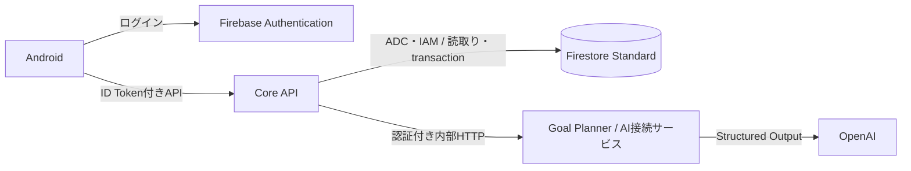

# データとシステム

## サービスの役割

| 配置先 | 担当 |
| --- | --- |
| Android | 画面、入力と確認、セッション内会話、グラフ、端末内の振り返り・通知 |
| Firebase Authentication | メール・パスワード認証、利用者IDとID Tokenの発行 |
| Core API | Token検証、所有者認可、業務ルール検証、DB transaction、保存と重複・競合の防止 |
| AI接続サービス | プロンプト、Structured Output生成、Provider接続、Fake、AI障害の変換 |
| Firestore Standard | 目標・計画・実績・再計画候補の永続化 |

AndroidはDBやOpenAIへ直接接続しません。Core APIはOpenAI SDK・キー・プロンプトを持ちません。
AI接続サービスはステートレスで、アプリのDBや利用者の認可を扱いません。
移管後のクラウド構成はCloud Run二つとFirestore、Secret Manager等を利用します。
ローカルでは同じ境界でFirestore Emulator・認証エミュレータ・Fakeを使えます。
2026-11-03 23:39（日本時間）にFirestore版へ切替済みです。旧Cloud SQLはユーザーの即時削除指示に基づき同日23:48に削除済みです。
採用判断は[ADR 0003](decisions/0003-firestore-standard.md)、段階と完了条件は[移管計画](plans/firestore-standard-migration.md)を参照してください。

## 保存するデータ

| データ | 意味 |
| --- | --- |
| Goal | 所有者ID、タイトル、任意の説明、期限、状態、計画の版、作成・更新日時 |
| Metric | 目標内の測定項目。名前、単位、目標値、現在値、表示順、非表示日時 |
| Milestone | 中間目標のタイトル、期限、表示順。完了状態は保持しない |
| ProgressLog | 実績の文章、記録日時、再送を識別するID |
| ProgressMetricUpdate | 実績に紐づくMetricごとの今回の増分 |
| ReplanProposal | 所有者、対象目標、基準の計画版、見直し理由、候補計画、差分、適用状態 |

Metricは正の数値を加算する形式です。AIが独自のテーブル、Metric型、可視化形式を生成する仕組みはありません。
会話履歴と通知設定はこのDBに保存しません。会話はセッション内、通知設定は利用者別の端末内保存です。

## 保存と競合

新規計画は確認後にGoal・Metric・Milestoneをまとめて保存します。
実績はGoal文書と保存IDをtransactionで読み、今回値の加算と履歴保存を一つのtransactionで行います。
同じGoalの同じ保存IDは再反映せず、現在のGoalを返します。

再計画は候補だけを先に保持します。適用transactionでGoalと候補を読み、基準の計画版が一致する場合だけ更新します。
使わなくなったMetricは削除せず非表示化し、過去の実績との参照を残します。
AIを待つ間は読取りtransactionを保持しません。

固定上限のMetric・Milestoneは`goals/{id}`へ格納し、実績と候補はサブコレクションへ分離します。
小数は100倍の整数、保存IDはSHA-256の文書ID、形式の版は`schema_version=1`で管理します。
詳細は同一snapshotの全履歴、助言は直近10件を読みます。一覧とコーチは所有Goalだけを索引で取得します。
クライアント向けRulesは全拒否とし、CoreのIAM権限を対象DBに限定します。

## 認証と情報の境界

業務APIはFirebase ID Tokenを検証し、uidをGoalの所有者として扱います。
存在しないGoalと他人のGoalはともに404です。AIにも所有者で絞ったデータだけを渡します。
認証情報・OpenAIキーはAIの入力に含めず、Providerのエラー全文や利用者本文を障害応答に露出しません。
内部Cloud Runへの呼出しにはCoreのサービスアカウントを使い、OpenAI Secretは内部AIサービスだけが参照します。

具体的な入力・応答は[API](api.md)、AIへ渡す情報と制約は[AIの動作](progress-ai-quality.md)を参照してください。

## コードの単位

Core APIの`goals.py`、`progress.py`、`replan.py`、`coach.py`には、それぞれのAPIと業務処理をまとめます。
AI通信・認証・DB接続は共通の境界として分け、`main.py`はアプリの組み立てだけを担当します。
内部AIサービスでは機能別の生成処理を保ち、`provider.py`へSDK通信と失敗の扱いを集約します。
Androidの`ui/`は認証・一覧・新規作成・詳細・コーチ・振り返り・グラフごとに、
表示・状態・ViewModelを同じファイルに置きます。通信とデータは`data/`、OS通知は`reminders/`、Android音声認識との接続は`speech/`に置きます。

音声入力はAndroid → OSの音声認識サービスという別の境界を使います。
API 31以降で利用可能なら端末内認識を選び、それ以外は説明・本人操作後に既定サービスを使います。
認識失敗時に端末内から外部サービスへ自動切替はしません。本人が既定サービスへの切替を選び、送信先の説明を確認して再度録音開始を選んだ場合だけ使います。Core API・内部AIサービスへ渡すのは、本文に追加して本人が送信した文字列だけです。
