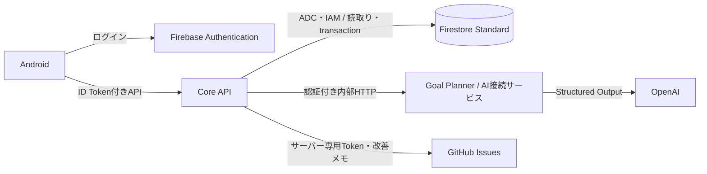

# データとシステム

## サービスの役割

| 配置先 | 担当 |
| --- | --- |
| Android | 画面、入力と確認、セッション内会話、グラフ、端末内の振り返り・通知 |
| Firebase Authentication | メール・パスワード／Google認証、アカウント連携、利用者IDとID Tokenの発行 |
| Core API | Token検証、所有者認可、業務ルール検証、DB transaction、保存と重複・競合の防止 |
| AI接続サービス | プロンプト、Structured Output生成、Provider接続、Fake、AI障害の変換 |
| Firestore Standard | 目標・計画・実績・再計画候補の永続化 |
| GitHub Issues | 改善メモ本文・整理・開発状況の正本 |

AndroidはDBやOpenAIへ直接接続しません。Core APIはOpenAI SDK・キー・プロンプトを持ちません。
AI接続サービスはステートレスで、アプリのDBや利用者の認可を扱いません。
移管後のクラウド構成はCloud Run二つとFirestore、Secret Manager等を利用します。
ローカルでは同じ境界でFirestore Emulator・認証エミュレータ・Fakeを使えます。
2026-11-03 23:39（日本時間）にFirestore版へ切替済みです。旧Cloud SQLはユーザーの即時削除指示に基づき同日23:48に削除済みです。
採用判断は[ADR 0003](decisions/0003-firestore-standard.md)、段階と完了条件は[移管計画](plans/firestore-standard-migration.md)を参照してください。

## デプロイ時の検証

mainの検査成功後、CoreとPlannerの候補版を準備し、確認後に配信を切り替えます。
Coreの候補版は、同じ実行で配置したPlannerのタグURLへ固定します。
非公開の検証JobはCoreと同じimage・実行アカウントを使い、Job内だけで検証用UIDの認証へ置き換えます。
公開サービスの認証・許可UIDは維持し、検証用データだけを削除します。手順と復旧は[GCP運用](../infra/gcp/README.md#デプロイ)を参照します。

## 保存するデータ

| データ | 意味 |
| --- | --- |
| Goal | 所有者ID、タイトル、任意の説明、期限、状態、計画の版、作成・更新日時 |
| Metric | 目標内の測定項目。固定種別、名前、単位、目標値、現在値、チェック定義・完了項目、最終記録日時、表示順、非表示日時 |
| Milestone | 中間目標のタイトル、期限、表示順。完了状態は保持しない |
| ProgressLog | 実績の文章、記録日時、再送を識別するID |
| ProgressMetricUpdate | 実績に紐づくMetricの種別と値、完了項目、実行日 |
| ReplanProposal | 所有者、対象目標、基準の計画版、見直し理由、候補計画、差分、適用状態 |

Metricの固定種別は累計・実行日・測定値・チェックリストです。Coreが種別ごとの意味を検証します。
累計は0も履歴に残し、現在値の目標超過を許容します。
AIは定義済み4種から選ぶだけで、独自のテーブル、型、可視化形式は生成しません。
会話履歴と通知設定はこのDBに保存しません。会話はセッション内、通知設定は利用者別の端末内保存です。

改善メモはCoreからGitHub Issuesへ送ります。Firestoreの`feedback_receipts`は本文を持たず、
重複送信防止に必要なハッシュ・送信先・状態・日時・Issue番号だけを保持します。
GitHub TokenはCoreだけがSecret Managerから取得します。Android・AI接続サービスには渡しません。
外部送信の境界と結果不明時の方針は[ADR 0005](decisions/0005-feedback-github-issues.md)を参照します。

## 保存と競合

新規計画は確認後にGoal・Metric・Milestoneをまとめて保存します。
実績はGoal文書と保存IDをtransactionで読み、種別に応じた現在値の更新と履歴保存を一つのtransactionで行います。
同じGoalの同じ保存IDは再反映せず、現在のGoalを返します。

再計画は候補だけを先に保持します。適用transactionでGoalと候補を読み、基準の計画版が一致する場合だけ更新します。
使わなくなったMetricは削除せず非表示化し、過去の実績との参照を残します。
AIを待つ間は読取りtransactionを保持しません。

固定上限のMetric・Milestoneは`goals/{id}`へ格納し、実績と候補はサブコレクションへ分離します。
小数は100倍の整数、保存IDはSHA-256の文書IDで管理します。
GoalとProgressLogの新規保存・更新は`schema_version=2`です。旧版1も読み、種別省略を累計として扱います。
旧履歴は書き換えず、Goalは次の書込み時に新版へ移します。一括移管や既存データの削除は不要です。
実行日型の重複防止は`goals/{id}/activity_days/{metric_uuid}_{date}`に保存する固定版1の記録参照で行います。
Goal・保存ID・該当暦日をtransactionで読み、現在値・履歴・暦日を原子的に保存します。
測定値とチェック状態は置換、累計と日数は加算します。チェックは期待する旧状態との比較で競合を拒否します。
再送では暦日も固定し、同じ保存IDなら二重反映しません。暦日参照も再送防止のためGoalに紐づけて保持します。
型・単位・チェック定義は保存後の再計画で変更せず、既存実績の意味を維持します。
詳細はGoalのサーバーread_timeと同一時点の全履歴、助言は直近10件を読みます。一覧とコーチは所有Goalだけを索引で取得します。
クライアント向けRulesは全拒否とし、CoreのIAM権限を対象DBに限定します。

## 認証と情報の境界

業務APIはFirebase ID Tokenを検証し、uidをGoalの所有者として扱います。
個人利用中のクラウド環境では、既存の本人アカウントをFirebase管理APIで照合し、そのuidを`ALLOWED_USER_ID`へ固定します。
共通認証依存関係でToken検証後にuidを照合し、不許可の利用者はDB操作・AI呼出し前に403とします。
Cloud Runでは許可uid未設定・空文字・Fake認証の構成で起動しません。ローカル・CIは未設定で複数利用者を検証できます。
メールアドレス変更は同一uidの許可を変えません。アカウントを削除・再作成した場合、新しいuidを自動許可しません。
存在しないGoalと他人のGoalはともに404です。AIにも所有者で絞ったデータだけを渡します。
認証情報・OpenAIキーはAIの入力に含めず、Providerのエラー全文や利用者本文を障害応答に露出しません。
内部Cloud Runへの呼出しにはCoreのサービスアカウントを使い、OpenAI Secretは内部AIサービスだけが参照します。

具体的な入力・応答は[API](api.md)、AIへ渡す情報と制約は[AIの動作](progress-ai-quality.md)を参照してください。

## コードの単位

Core APIの`goals.py`、`progress.py`、`replan.py`、`coach.py`には、それぞれのAPIと業務処理をまとめます。
AI通信・認証・DB接続は共通の境界として分け、`main.py`はアプリの組み立てだけを担当します。
内部AIサービスでは機能別の生成処理を保ち、`provider.py`へSDK通信と失敗の扱いを集約します。
Androidの`ui/`は認証・一覧・新規作成・詳細・コーチ・振り返り・グラフごとに、
表示・状態・ViewModelを同じファイルに置きます。通信とデータは`data/`、OS通知は`reminders/`、Android音声認識との接続は`speech/`に置きます。

音声入力はAndroid → OSの音声認識サービスという別の境界を使います。
API 31以降で利用可能なら端末内認識を選び、それ以外は説明・本人操作後に既定サービスを使います。
認識失敗時に端末内から外部サービスへ自動切替はしません。本人が既定サービスへの切替を選び、送信先の説明を確認して再度録音開始を選んだ場合だけ使います。Core API・内部AIサービスへ渡すのは、本文に追加して本人が送信した文字列だけです。

Googleのアカウント選択はAndroid Credential Managerが担当します。Google ID TokenはFirebase SDKで検証・交換し、Core APIの認可はFirebase uidのままです。
既存アカウントからの連携は`linkWithCredential`を使い、別アカウントの所有権を移しません。
Firebaseの認証変更は直列化し、取消済みのTaskが完了してもログアウトを後から打ち消さないようにします。
画面状態はログインごとのセッションで分け、遅い結果や未保存入力を次のログインへ引き継ぎません。

Goalの状態は `active` / `completed` です。既存文書はactiveのまま移管不要です。
完了は既存goals.pyがGoal文書のtransactionで確定し、実績保存・再計画適用も同じ文書を読んで完了後の書込みを拒否します。
アーカイブは状態による一覧の分離であり、データの削除・別コレクションへの移動は行いません。
完了済み文書が作成された後は、`completed` を読めない旧Core版へのロールバックはできません。
その場合の修正・復旧には、この状態値を読めるCoreイメージを使用します。

種別対応後に保存・更新した版2文書は、旧Coreの固定モデルで読めません。
ロールバックは版2と全種別を読めるCore、および対応するPlannerの組合せへ行います。
旧Android向けの累計APIは維持し、新種別の保存には明示的なkindを要求して意味の誤解を防ぎます。
